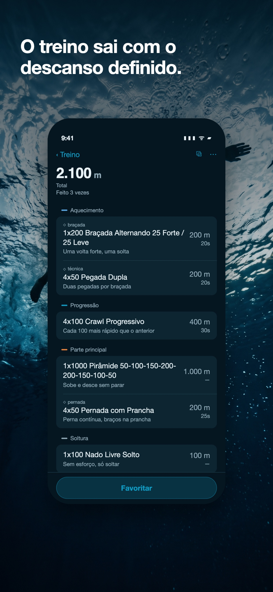
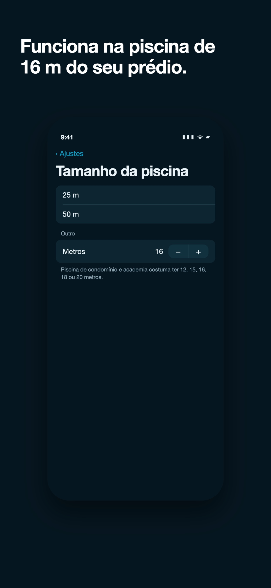
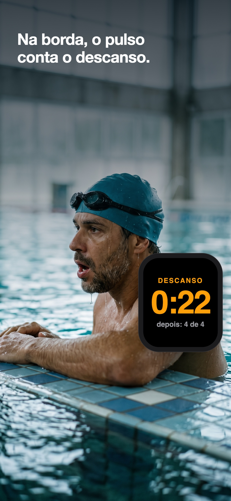
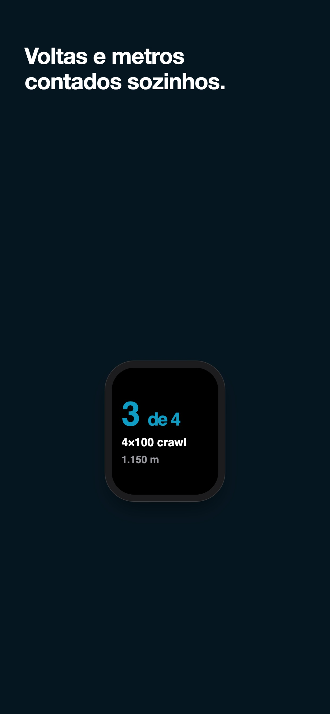
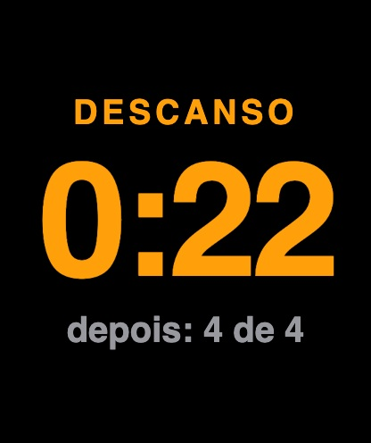
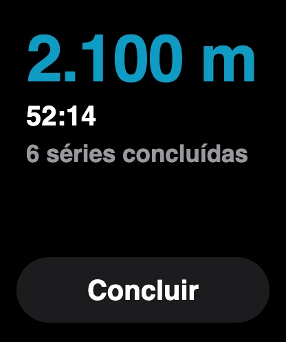

# Vou Nadar

App de natação para iPhone e Apple Watch: gera o treino no aparelho e executa no pulso, com o descanso de cada bloco já definido.

[Baixar na App Store](https://apps.apple.com/br/app/vou-nadar/id6809237350)

<p>
  
  
  
  
</p>
<p>
  
  
  
</p>

O nadador diz quanto quer nadar, que equipamento tem na mochila e qual é o tamanho da piscina. O app monta um treino completo — aquecimento, progressão, parte principal e soltura — com o descanso de cada bloco já definido. No Apple Watch, o treino roda sozinho: conta as voltas pela distância do HealthKit, avisa por vibração quando entra e quando sai do descanso, e grava a sessão no app Saúde no fim.

Em português. Sem conta, sem login, sem servidor.

## Principais funcionalidades

- **Piscina de qualquer tamanho, de 10 a 50 m.** Piscina de condomínio de 16 m é caso de primeira classe: o `4×100` do catálogo vira `4×96` — seis voltas —, e é `4×96` que aparece na tela, no relógio e no total.
- **Descanso automático no pulso.** Nenhuma ação obrigatória depende de tocar na tela durante o treino. O visor está molhado e a mão, na água.
- **Funciona com o iPhone desligado.** O relógio gera treino sozinho, com o catálogo embarcado. Nada no app de treino depende de rede.
- **Catálogo de 226 exercícios** vindos de experiência real de nadadores amadores, não gerados por IA.
- **O treino salvo é imutável.** Descanso, distância adaptada e voltas são congelados na geração e nunca recalculados na leitura.
- Favoritos sincronizados do iPhone para o relógio, histórico vindo do app Saúde e volume da semana numa complication do mostrador.
- Gerar treino é sempre livre; as 3 primeiras execuções guiadas também. Depois disso, uma compra única libera a execução guiada.

## Stack técnica

- Swift + SwiftUI, iOS 18.0+ (iPhone, retrato) e watchOS 11.0+
- SwiftData (armazenamento local)
- HealthKit (o relógio grava a sessão; o iPhone só lê)
- WatchConnectivity (sincronização iPhone → relógio)
- WidgetKit (complication)
- StoreKit 2 (compra única não-consumível)
- XcodeGen (`project.yml` gera o projeto Xcode)
- Swift Testing (testes unitários)

Zero dependências de terceiros: não há Swift Package, não há chave de API nem variável de ambiente.

## Como foi construído

Desenvolvido com Claude (Anthropic) a partir de uma especificação SDD: [spec-vou-nadar.md](spec-vou-nadar.md). A spec define princípios, modelo de dados, regras de negócio, fluxos, critérios de aceite e copy. O repositório tem estes guardrails:

- [`CLAUDE.md`](CLAUDE.md) com as instruções para quem mexer no código, humano ou agente: regras de arquitetura, comandos, "seis coisas que quebram em silêncio" e o que não implementar.
- 214 testes em 21 suítes em [`VouNadarTests/`](VouNadarTests/): gerador de treino, adaptação ao tamanho da piscina, descanso, execução e contagem de voltas, sincronização, compra, repositórios e integridade do catálogo.
- Um teste de arquitetura (`SharedSourcePurityTests`) que reprova o build se as fontes compartilhadas entre iPhone e relógio importarem framework de plataforma, e outro (`SymbolsTests`) que valida cada SF Symbol usado.
- Build sem warnings como critério de aceite: `SWIFT_TREAT_WARNINGS_AS_ERRORS` ligado nos três targets de app.

Documentação complementar:

| Documento | Para quê |
|---|---|
| [`spec-vou-nadar.md`](spec-vou-nadar.md) | O comportamento: modelo de dados, regras de negócio, fluxos, critérios de aceite, copy |
| [`prompt-design-vou-nadar.md`](prompt-design-vou-nadar.md) | A implementação visual: tokens, tipografia, componentes, símbolos |
| [`DOCUMENTACAO-TECNICA.md`](DOCUMENTACAO-TECNICA.md) | O sistema como ficou, incluindo as divergências em relação ao spec |
| [`CLAUDE.md`](CLAUDE.md) | Como mexer no repositório sem quebrar o que quebra em silêncio |

## Status

Publicado na App Store (iPhone e Apple Watch). Falta o teste em piscina real — ver a checklist da seção 26 do `spec-vou-nadar.md`.

## Licença

O código está disponível apenas para leitura e estudo. Veja [LICENSE](LICENSE).

## Contribuições

Issues são bem-vindas; pull requests não são aceitos. Veja [CONTRIBUTING.md](CONTRIBUTING.md).

## Como rodar

Requisitos: Xcode 26 ou mais recente e [XcodeGen](https://github.com/yonaskolb/XcodeGen) (`brew install xcodegen`).

O projeto é **gerado** a partir do `project.yml` — o `.xcodeproj` não é versionado e não é editado à mão.

```bash
xcodegen generate
open VouNadar.xcodeproj
```

Rode `xcodegen generate` toda vez que adicionar, mover ou apagar um arquivo.

Testes:

```bash
xcodebuild -project VouNadar.xcodeproj -scheme VouNadar -destination 'platform=iOS Simulator,name=iPhone 17 Pro' -configuration Debug CODE_SIGNING_ALLOWED=NO test
```

### Estrutura

```
VouNadar/                    app do iPhone
  Domain/                    regras puras — gerador, descanso, execução, sync
  Data/                      catálogo, modelos SwiftData, repositórios, HealthKit, StoreKit
  DesignSystem/              tokens, copy, símbolos, componentes
  Features/                  as telas
VouNadarWatch/               app do relógio — executa o treino e grava no Saúde
VouNadarWatchComplication/   volume da semana no mostrador
VouNadarTests/               testes
```

`Domain/`, `Data/Catalog/`, `Data/Enums/`, `Data/Models/`, `Data/Schema/` e `Data/Repositories/` são compilados nos **dois** apps e não importam framework de plataforma — é isso que faz o relógio funcionar sozinho.

### Privacidade

Nenhum dado sai do aparelho. Não há analytics, não há rastreamento, não há conta. Os treinos ficam no SwiftData local e as sessões no app Saúde, que é do usuário. A única comunicação com a rede é comprar e restaurar a compra na App Store.

Apagar o app apaga os treinos. As sessões no app Saúde permanecem — são dado de saúde do usuário, não nosso.

---

Feito pela [Dab Lab](https://www.dablab.com.br/) — agência de inovação no-code para startups e PMEs, com automações usando IA.
