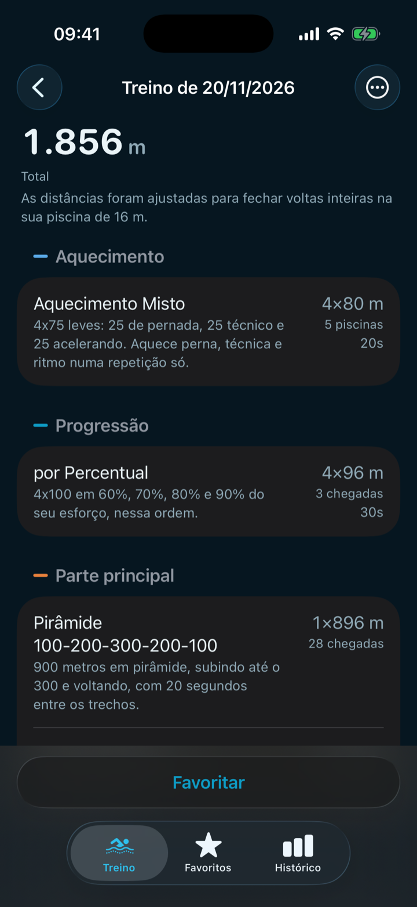
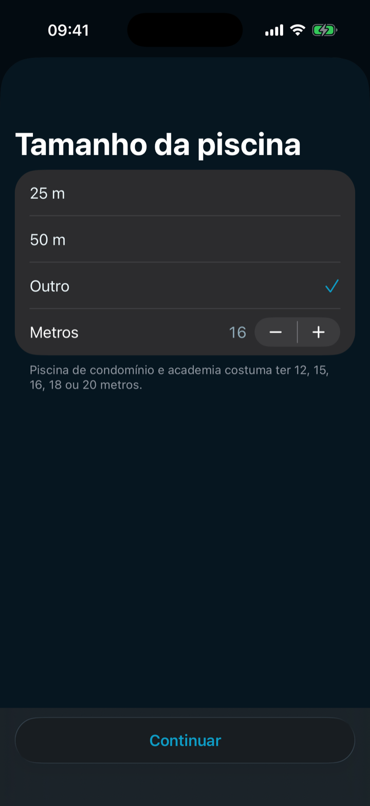
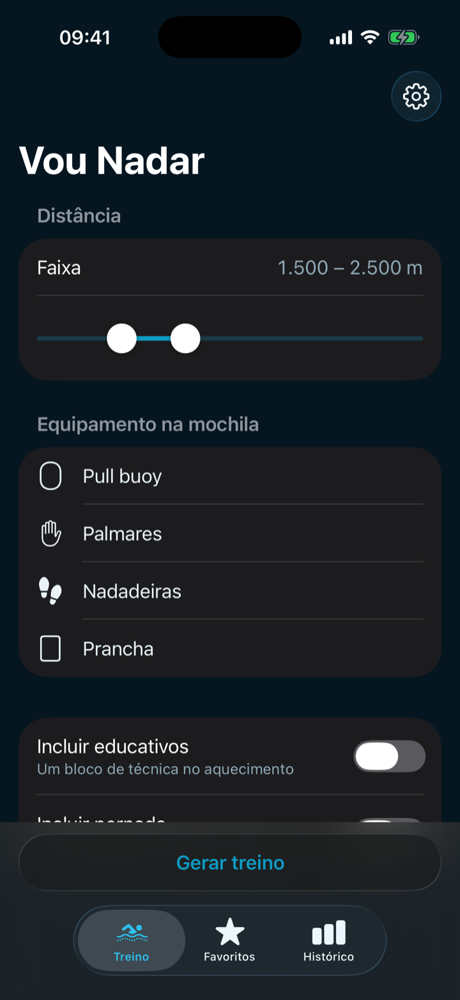
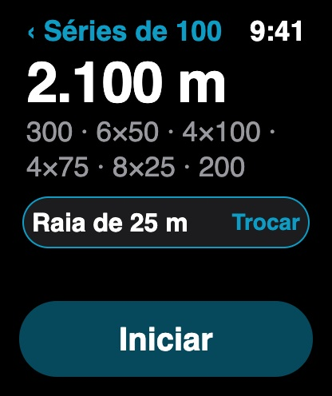
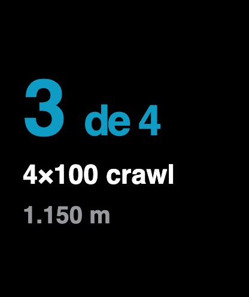

# Vou Nadar

<p align="center">
  
  &nbsp;
  
  &nbsp;
  
</p>

<p align="center">
  <a href="https://apps.apple.com/br/app/vou-nadar/id6809237350"><b>Baixar na App Store</b></a> ·
  <a href="spec-vou-nadar.md">Especificação</a> ·
  <a href="DOCUMENTACAO-TECNICA.md">Documentação técnica</a> ·
  <a href="LICENSE">Licença</a>
</p>

O **Vou Nadar** monta o seu treino de piscina e o executa no seu pulso. Você diz quanto quer nadar, o que levou na mochila e qual é o tamanho da piscina; o app devolve um treino completo — aquecimento, progressão, parte principal e soltura — com o descanso de cada bloco já definido. No Apple Watch, o treino roda sozinho: conta as voltas pela distância medida, avisa por vibração quando entra e quando sai do descanso, e grava a sessão no app Saúde no fim.

Em português. Sem conta, sem login, sem servidor.

É um produto da [Dab Lab](https://www.dablab.com.br/).

## Funciona na piscina do seu prédio

Piscina de 12, 15, 16, 18 ou 20 metros não é exceção: é caso de primeira classe. O app adapta cada exercício ao número de voltas inteiras mais próximo, e o `4×100` do catálogo vira `4×96` na raia de 16 m. É esse número que aparece na tela, no relógio e no total do treino — nunca o do catálogo. De 10 a 50 metros.

Em piscina fora do padrão, cada série também diz **quantas vezes bater na parede**: `4×96 m` são 3 chegadas (ida e volta), e `4×80 m` são 5 piscinas, quando as travessias não fecham em pares. É a conta que ninguém quer fazer de cabeça na borda.

## O treino no pulso

<p align="center">
  
  &nbsp;
  
  &nbsp;
  
</p>

Toque em Iniciar e guarde o iPhone. **Nenhuma ação obrigatória depende de tocar na tela durante o treino** — o visor está molhado e a mão, na água. O relógio conta as voltas, muda de série sozinho, vibra ao entrar no descanso, vibra de novo nos três segundos finais e vibra ao sair.

Descansar mais que o previsto não adianta nada: quando a contagem zera, o relógio avisa e espera a próxima volta. Dá para calçar a nadadeira com calma.

<p align="center">
  
</p>

No fim, a sessão vira um treino de natação no app Saúde, com distância, duração e tamanho da raia.

## O que mais tem

- **Funciona com o iPhone desligado.** O relógio gera treino sozinho, com o catálogo embarcado. Nada no app de treino depende de rede.
- **Catálogo de 226 exercícios** montados a partir da experiência de atletas amadores, não gerados por IA.
- **O treino salvo é imutável.** Descanso, distância adaptada e voltas são congelados na geração e nunca recalculados na leitura — um favorito não muda sozinho depois de uma atualização do app ou de uma troca de piscina.
- **Favoritos** salvos no iPhone aparecem no relógio sozinhos.
- **Histórico** com o volume por semana, lido do app Saúde, e uma complication com o volume da semana no mostrador.
- **Copiar como texto**, para colar o treino onde quiser.

## Quanto custa

Gerar treino é sempre grátis, no iPhone e no relógio. As três primeiras execuções guiadas no Apple Watch também. Depois disso, uma compra única de R$ 49,90 libera a execução guiada para sempre. Sem assinatura, sem anúncio.

## Stack técnica

- Swift 6 com concorrência estrita e SwiftUI; iOS 18.0+ (iPhone, retrato) e watchOS 11.0+
- SwiftData para o armazenamento local, com schema versionado
- HealthKit: o relógio grava a sessão, o iPhone só lê
- WatchConnectivity para a sincronização iPhone → relógio, de mão única
- WidgetKit para a complication do mostrador
- StoreKit 2 para a compra única não-consumível
- XcodeGen: o `project.yml` gera o projeto Xcode, que não é versionado
- Swift Testing: 214 testes em 21 suítes

**Zero dependências de terceiros**: não há Swift Package, não há chave de API e não há variável de ambiente.

## Como foi construído

Desenvolvido com o Claude (Anthropic) a partir de uma especificação SDD: [`spec-vou-nadar.md`](spec-vou-nadar.md), que define princípios, modelo de dados, regras de negócio, fluxos, critérios de aceite e a copy de cada tela. O repositório tem estes guardrails:

- Um teste de arquitetura (`SharedSourcePurityTests`) que **reprova o build** se as fontes compartilhadas entre iPhone e relógio importarem framework de plataforma. É o que garante que o relógio funcione sozinho.
- Outro (`SymbolsTests`) que resolve cada SF Symbol usado — nome errado não quebra a compilação, vira um quadrado vazio em produção.
- Varreduras sobre o catálogo real: os 226 exercícios nas oito piscinas da tabela do spec, e a tabela de descanso nos três ritmos, sem valor fora de 10–90 s.
- Build sem nenhum warning como critério de aceite, com `SWIFT_TREAT_WARNINGS_AS_ERRORS` ligado nos três targets de app.

| Documento | O que é |
|---|---|
| [`spec-vou-nadar.md`](spec-vou-nadar.md) | Especificação do comportamento (fonte única de verdade) |
| [`prompt-design-vou-nadar.md`](prompt-design-vou-nadar.md) | A implementação visual: tokens, tipografia, componentes, símbolos |
| [`DOCUMENTACAO-TECNICA.md`](DOCUMENTACAO-TECNICA.md) | O sistema como ficou, com as divergências em relação ao spec |
| [`CLAUDE.md`](CLAUDE.md) | Guia para sessões do Claude Code neste repositório |
| [`app-store/`](app-store/) | A ficha da loja e o roteiro das imagens |

## Privacidade

Nenhum dado sai do aparelho. Não há analytics, não há rastreamento, não há conta. Os treinos ficam no SwiftData local e as sessões no app Saúde, que é do usuário. A única comunicação com a rede é comprar e restaurar a compra na App Store.

Apagar o app apaga os treinos. As sessões no app Saúde permanecem — são dado de saúde do usuário, não nosso.

## Contribuições

Issues são bem-vindas: bugs, dúvidas e sugestões. Veja [CONTRIBUTING.md](CONTRIBUTING.md).

---

# Rodar

## Antes de começar

| Ferramenta | Versão | Para quê |
|---|---|---|
| Xcode | 26+ | tudo |
| XcodeGen | 2.44+ | gera o `.xcodeproj` a partir do `project.yml` |
| Plataforma watchOS | 11+ | build e simulador do relógio |

```bash
brew install xcodegen
xcodebuild -downloadPlatform watchOS          # ~3,8 GB
```

## Rodando

O projeto é **gerado** pelo `project.yml`. O `.xcodeproj` está no `.gitignore` e não é editado à mão.

```bash
xcodegen generate
open VouNadar.xcodeproj
```

Rode `xcodegen generate` toda vez que adicionar, mover ou apagar um arquivo. É o erro mais fácil de cometer aqui: criar um arquivo, ver "cannot find type X in scope" e procurar o problema no código.

## Testes

```bash
xcodebuild -project VouNadar.xcodeproj -scheme VouNadar \
  -destination 'platform=iOS Simulator,name=iPhone 17 Pro' \
  -configuration Debug CODE_SIGNING_ALLOWED=NO test
```

## Estrutura

```
VouNadar/                    app do iPhone
  Domain/                    regras puras — gerador, descanso, execução, sync, compra
  Data/                      catálogo, modelos SwiftData, repositórios, HealthKit, StoreKit
  DesignSystem/              tokens, copy, símbolos, componentes
  Features/                  as sete telas
VouNadarWatch/               app do relógio — executa o treino e grava no Saúde
VouNadarWatchComplication/   volume da semana no mostrador
VouNadarTests/               214 testes em 21 suítes
```

`Domain/`, `Data/Catalog/`, `Data/Enums/`, `Data/Models/`, `Data/Schema/` e `Data/Repositories/` são compilados nos **dois** apps e não importam framework de plataforma. É isso que faz o relógio gerar treino com o iPhone desligado — e há um teste que reprova o build se alguém quebrar a regra.

---

## Licença

O código está aberto para leitura e estudo, nos termos do [LICENSE](LICENSE).

Feito pela [Dab Lab](https://www.dablab.com.br/), product studio de software e IA que constrói apps para pequenas empresas, startups e áreas dentro de grandes empresas, partindo de uma especificação (Spec-Driven Development) e com as disciplinas de engenharia de software robusta.
